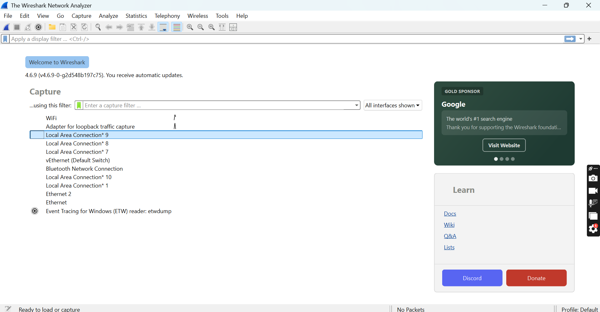
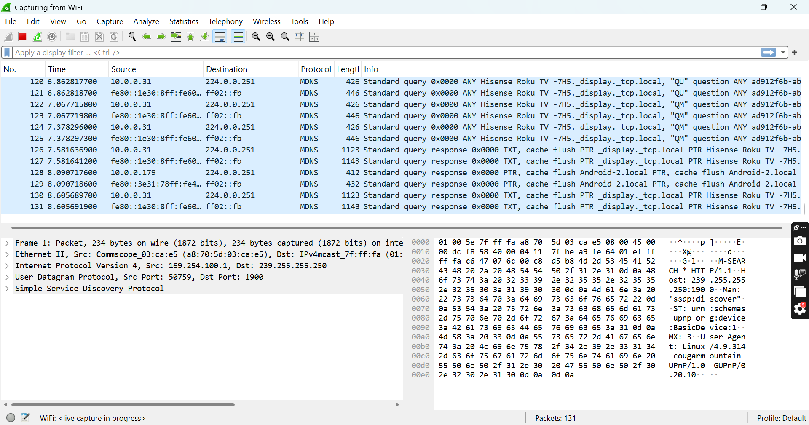
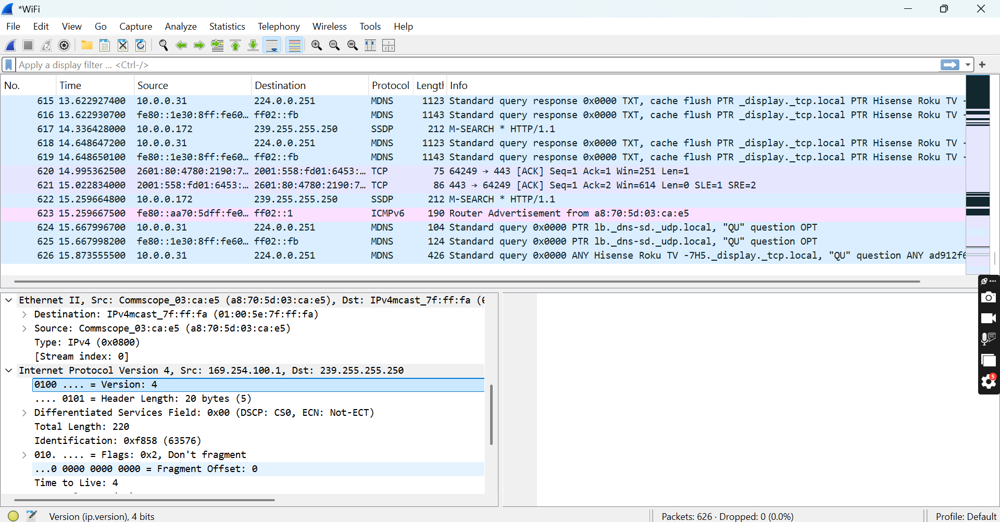

# 🔐 Cybersecurity Internship – B084
## Week 1: Wireshark Installation, Configuration & Network Traffic Analysis

**NETWORKWALKS | CYBERSECURITY & PENETRATION TESTING INTERNSHIP**

**Hands-On Network Packet Capture, Protocol Analysis, Traffic Monitoring & Cybersecurity Investigation**

---

## 📌 Project Overview

This repository documents my hands-on experience with **Wireshark installation, configuration, and network traffic analysis** during Week 1 of the Networkwalks Cybersecurity and Penetration Testing Internship (Batch B084).

The primary focus of this project is to develop practical cybersecurity skills using Wireshark, an open-source network protocol analyzer designed to capture, inspect, monitor, and troubleshoot network communications.

As part of my training, I successfully installed Wireshark 4.6.9 on Windows 11 and explored its functionality within Kali Linux running through Oracle VirtualBox.

I identified available network interfaces, selected Wi-Fi for live packet capture, and examined captured traffic to understand network communication and protocol behavior.

The practical learning activities include:

- Wireshark installation and initial configuration.
- Identifying available network interfaces.
- Capturing and examining live network traffic.
- Understanding TCP, UDP, mDNS, SSDP, and ICMPv6.
- Exploring Wireshark display filters.
- Inspecting source and destination IP addresses.
- Examining Ethernet and IPv4 packet headers.
- Developing foundational SOC investigation skills.

---

## 🎯 Project Objectives

1. Install and configure Wireshark on Windows 11.
2. Understand Wireshark's interface and features.
3. Identify network interfaces for packet capture.
4. Capture live Wi-Fi network traffic.
5. Examine packet source and destination addresses.
6. Identify network protocols and communication patterns.
7. Inspect Ethernet, IPv4, and UDP packet fields.
8. Practice Wireshark display filters.
9. Develop practical network troubleshooting skills.
10. Build foundational knowledge for SOC investigations.

---

## 🛠️ Primary Tool

**Wireshark 4.6.9 – Network Protocol Analyzer**

Wireshark is the primary application used throughout this project.

**Supporting Environment:**
- Windows 11
- Kali Linux
- Oracle VirtualBox
- Wi-Fi Network Interface

---

## 🖥️ Step 1: Wireshark Installation and Configuration

I installed Wireshark on Windows 11 and launched the application to verify successful installation.

The application displayed multiple network interfaces, including Wi-Fi, Ethernet, loopback, and virtual network adapters.

### Screenshot 1: Wireshark Interface

*Figure 1: Wireshark 4.6.9 showing available network interfaces.*

---

## 📡 Step 2: Live Network Packet Capture

I selected the Wi-Fi interface and started a live network capture.

Wireshark displayed captured packets with the following information:

- Packet number
- Capture time
- Source IP address
- Destination IP address
- Protocol
- Packet length
- Packet information

### Screenshot 2: Live Packet Capture

*Figure 2: Live Wi-Fi packet capture showing mDNS traffic and SSDP packet details.*

### Observations

During the capture, I observed:

- mDNS multicast traffic to 224.0.0.251.
- SSDP discovery traffic to 239.255.255.250.
- UDP communication using port 1900.
- Local network device discovery messages.

These observations demonstrate normal service-discovery activity and do not independently indicate malicious behavior.

---

## 🔎 Step 3: Network Packet Inspection

I explored the packet details panel to understand how Wireshark organizes captured network communication.

The inspection included:

- Ethernet frame information
- IPv4 source and destination addresses
- IP header version and length
- Packet fragmentation flags
- Time to Live (TTL)
- Protocol information

### Screenshot 3: Packet Header Analysis

*Figure 3: Expanded Ethernet and IPv4 packet header fields.*

The screenshot also shows TCP, SSDP, mDNS, and ICMPv6 traffic.

At the time of capture, Wireshark displayed:

**626 packets captured | 0 packets dropped**

---

## 🧪 Step 4: Wireshark Display Filters

Wireshark display filters help isolate specific traffic for investigation.

The following filters are useful for continued practice:

| Protocol / Investigation | Display Filter |
|---|---|
| TCP | `tcp` |
| UDP | `udp` |
| DNS | `dns` |
| HTTP | `http` |
| ICMP | `icmp` |
| ICMPv6 | `icmpv6` |
| Multicast DNS | `mdns` |
| SSDP | `ssdp` |
| Specific IP address | `ip.addr == 10.0.0.31` |
| UDP Port 1900 | `udp.port == 1900` |
| Initial TCP SYN packets | `tcp.flags.syn == 1 && tcp.flags.ack == 0` |

**Note:** These are practice filters for future analysis. The screenshots do not demonstrate that every filter was applied.

---

## 📊 Network Traffic Observations

| Observed Traffic | Interpretation |
|---|---|
| mDNS | Local multicast service discovery |
| SSDP | Network device and service discovery |
| TCP ACK | Acknowledgment in TCP communication |
| ICMPv6 | IPv6 network control messaging |
| IPv4 Header | Network-layer addressing and packet information |
| UDP | Connectionless transport protocol |

These observations helped me understand how devices communicate and exchange information within a network.

---

## 📚 Learning Outcomes

Through this practical project, I developed a better understanding of:

1. Installing and configuring Wireshark.
2. Identifying and selecting capture interfaces.
3. Capturing live network traffic.
4. Reading and interpreting packet information.
5. Inspecting Ethernet and IPv4 headers.
6. Understanding common network protocols.
7. Applying display filters for network investigation.
8. Identifying local network discovery activity.
9. Using Wireshark for network troubleshooting.
10. Understanding the importance of packet analysis in cybersecurity and SOC operations.

---

## 🛡️ Ethical Security Statement

All packet capture and network analysis activities documented in this repository are intended strictly for educational purposes and authorized cybersecurity training.

Network traffic should only be captured on systems and networks where appropriate permission has been granted.

---

## 👨‍💻 About the Author

**Lamidi Olatunji Micheal Eleshin**

Cybersecurity & Penetration Testing Intern | Aspiring Cybersecurity Analyst | IT Auditor | IT Support Engineer | GRC & Risk Management

**Specialization Areas:**

Cybersecurity | Network Security | IT Auditing | Governance, Risk & Compliance | Penetration Testing | SOC Operations

**Internship:** Networkwalks Cybersecurity & Penetration Testing

**Batch:** B084 | Week 1

**Project Focus:** Wireshark Installation, Packet Capture, Protocol Analysis & Network Security Monitoring

---

**"Cybersecurity begins with vigilance. Failure to prevent a threat today may become tomorrow's data disaster."**

*— Lamidi Olatunji Micheal Eleshin*

